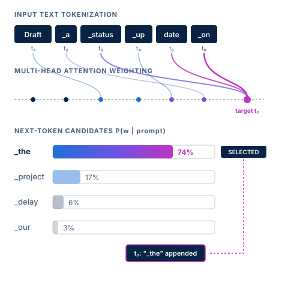
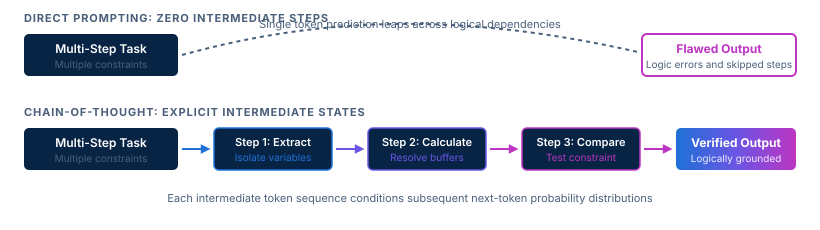

<!-- course-title: Prompt Engineering for Generative AI -->
<!-- course-theme: roi-alt-theme -->

<!-- layout: title -->


Prompt Engineering for Generative AI

# Chapter 1: Prompt Engineering for Generative AI

---

# Chapter 1: Objectives

- Apply structured prompting techniques and iterative refinement to generate accurate outputs in Gemini
- Understand how generative AI models interpret prompts and why prompt design matters
- Identify key components of a well-crafted prompt including persona, context, task, and constraints
- Apply core prompting patterns such as few-shot examples, system instructions, and structured outputs
- Diagnose flawed responses and iteratively refine prompts to reduce hallucinations and improve accuracy
- Build, test, and refine structured prompts directly within Google Gemini

---

<!-- layout: navigation -->
# Chapter 1

- **Foundations of Prompt Engineering**
- Essential Components of a Prompt
- Core Prompting Techniques
- Iterative Refinement and Error Handling
- Lab: Engineering Effective Prompts in Gemini

---

<!-- layout: 2-column -->
# What Prompt Engineering Is (and Is Not)

### What It Is
- **Intentional guidance**: steering model probabilities toward accurate, relevant responses
- **Structured specification**: providing context, roles, steps, and output contracts
- **Systematic optimization**: testing and refining instructions across multiple inputs

### What It Is Not
- **Magic spells**: searching for secret buzzwords that unlock hidden capabilities
- **Traditional coding**: deterministic syntax with guaranteed byte-identical output
- **Unchecked generation**: accepting the first response without verification

<!-- below-columns -->

> [!NOTE]
> Large language models are probabilistic text predictors. Prompt engineering reduces uncertainty by constraining the space of likely completions.

---

# Do Now: Test an Ambiguous Prompt

Run this in Gemini before we examine how language models process instructions.

- Open Gemini in your browser
- Submit this single prompt: `Write a short status update about our project delay.`
- Note what the model generated:
  - What project name or domain did it invent?
  - What reason did it give for the delay?
  - What revised deadline did it commit to?

---

# How LLMs Process Prompts

- **Tokens as building blocks**: models process text in sub-word token chunks
- **Attention mechanisms**: cross-token weights link words across the prompt context
- **Next-token prediction**: models calculate probabilities for each successive token
- **Context window budget**: prompt instructions and outputs share a finite token capacity



> [!IMPORTANT]
> If you leave a critical assumption unstated, the model will invent one based on general web training data rather than your specific reality.

---

<!-- layout: 2-column -->
# The Cost of Ambiguity

### Vague Prompt
- Prompt: `Write a customer status update about our delay.`
- Output: Generic apologies, fabricated delivery dates, unfocused scope
- Result: Instructor or teammate must spend 15 minutes rewriting the text

### Structured Prompt
- Prompt: `Draft a 150-word email to Director Sarah. State our database migration slips 3 days due to schema conflicts. Rollout is now Friday at 8 PM.`
- Output: Concise, factual, professional, and ready to send
- Result: Delivers the exact message in seconds

<!-- below-columns -->

> [!TIP]
> Treat the model like a capable junior colleague: give explicit instructions, boundaries, and clear success criteria.

---

<!-- layout: navigation -->
# Chapter 1

- Foundations of Prompt Engineering
- **Essential Components of a Prompt**
- Core Prompting Techniques
- Iterative Refinement and Error Handling
- Lab: Engineering Effective Prompts in Gemini

---

<!-- layout: card-layout -->
# Core Building Blocks of a Prompt

### Role and Persona
- Establish domain expertise, perspective, and intended audience depth.
- Direct the model toward specialized vocabulary and professional standards.

### Task and Objective
- State the core action verb and end goal immediately.
- Specific tasks such as critique, categorize, or draft prevent wandering text.

### Context and Source Data
- Supply reference materials, business rules, and constraints.
- Grounding the model in facts prevents hallucinated assumptions.

### Format and Constraints
- Define structure, length boundaries, and prohibited content.
- Explicit formats like JSON, bulleted lists, or tables simplify downstream use.

---

# Assigning Roles and Personas

- **Sets tone and technical depth**: a prompt written for a staff software architect produces different answers than one for a high school student
- **Frames evaluation criteria**: personas clarify what tradeoffs matter most
  - Senior Security Engineer: prioritizes least privilege and threat mitigation
  - Product Manager: prioritizes user adoption and time-to-market
- **Keep personas functional and grounded**: describe specific professional functions rather than theatrical fluff

> [!TIP]
> Use the formula: *“Act as an expert [Role]. Explain [Topic] to an audience of [Target Audience], emphasizing [Core Priority].”*

---

<!-- layout: 2-column -->
# Discuss: When Does a Persona Backfire?

### Prompt
A colleague begins every prompt with: *“Act as an omniscient world-class genius with 30 years of experience who knows everything about technology.”*

### Discuss
- What useful constraint does that instruction actually provide?
- How does that differ from naming a specific job function and audience?
- When can an exaggerated persona degrade response quality?

---

<!-- layout: 2-column -->
# Action Verbs vs Negative Constraints

### Direct Action Verbs
- Start instructions with precise, unambiguous action verbs
- Strong: `Extract`, `Compare`, `Summarize`, `Synthesize`, `Evaluate`
- Weak: `Look at this`, `Think about`, `Tell me about`, `Process`
- Avoid multi-part run-on sentences that bury the central task

### Explicit Constraints
- **Length limits**: specify word counts, paragraphs, or bullet thresholds
- **Tone parameters**: formal, technical, empathetic, or executive
- **Scope guards**: define topics that must not appear in the response
- **Structure targets**: mandate markdown tables, bullet lists, or CSV

<!-- below-columns -->

> [!WARNING]
> Negative constraints alone often fail. Always tell the model what to do *instead* of what to avoid (e.g., “Use neutral language instead of marketing jargon”).

---

# Anatomy of a Structured Prompt

- Clear delimiters separate instructions from reference material
- The model immediately sees who it is, what it must do, and how to format the answer

```text
Role: Senior Cloud Security Specialist
Task: Audit the configuration snippet below for public exposure risks.

Context:
{"bucket": "finance-reports", "public_read": true, "versioning": false}

Constraints:
- List identified risks in a markdown table: Severity | Finding | Remediation
- Limit findings to critical and high severity issues only
- Do not include conversational introductory or concluding text
```

---

<!-- layout: navigation -->
# Chapter 1

- Foundations of Prompt Engineering
- Essential Components of a Prompt
- **Core Prompting Techniques**
- Iterative Refinement and Error Handling
- Lab: Engineering Effective Prompts in Gemini

---

<!-- layout: 2-column -->
# Zero-Shot vs Few-Shot Prompting

### Zero-Shot Prompting
- Provides instructions and input data without sample answers
- Relies on pre-trained semantic knowledge and instruction-following
- Ideal for creative generation, open summarization, and direct translations
- Faster to write, but vulnerable to unexpected schema deviations

### Few-Shot Prompting
- Provides one to three completed input-output demonstration pairs
- Guides the model on edge cases, classification schemas, and tone
- Essential for rigid data transformation and domain-specific classification
- Drastically reduces the need for lengthy rule explanations

<!-- below-columns -->

> [!TIP]
> When a model struggles to follow complex formatting instructions, add two realistic examples instead of writing three more paragraphs of rules.

---

# Few-Shot Pattern in Practice

- Providing concrete input-output examples teaches the schema and classification rules simultaneously
- The model matches the pattern without requiring a formal grammar specification

```text
Classify incoming support tickets by category and urgency.

Input: "My payment failed but my credit card shows a pending charge."
Output: {"category": "Billing", "urgency": "High", "action": "Escalate"}

Input: "Can we customize the dashboard header color?"
Output: {"category": "Product", "urgency": "Low", "action": "Log Feature"}

Input: "System is down for our entire regional office!"
Output:
```

---

<!-- layout: 3-column -->
# Structuring Prompt Boundaries

### System Instructions
- Persistent operational guidelines set at session creation
- Establishes behavioral guardrails that resist user overrides
- Ideal for enterprise personas, brand voices, and compliance rules

### Delimiters
- Use clear markers: `"""`, `###`, or XML tags like `<data>`
- Creates a clean boundary between instructions and user inputs
- Mitigates prompt injection and accidental command interpretation

### Visual Hierarchy
- Use numbered lists for sequential processing steps
- Group related metadata under uppercase labels
- Makes complex prompts readable for humans and models alike

---

<!-- layout: stacked -->
# Guiding Reasoning: Chain-of-Thought

- Direct queries force the model to jump from input to final answer in a single token step
- Chain-of-thought creates intermediate token steps, where each deduction conditions the next
- Step-by-step reasoning sharply reduces arithmetic, deduction, and scheduling errors



> [!NOTE]
> Requesting step-by-step explanations consumes more output tokens and increases generation time, but delivers higher logical accuracy.

---

# Demo: Chain-of-Thought in Action

Show how forcing intermediate reasoning steps prevents logical errors.

```text
Task: Determine if our team has enough conference room time.

Context:
- Team Alpha reserved Room 204 from 9:00 AM to 11:30 AM.
- Team Beta needs 90 minutes starting at 11:00 AM.
- Room turnover requires a 15-minute cleaning buffer between meetings.

Instruction:
Think step by step before answering.
1. Identify when Team Alpha vacates the room.
2. Add the required cleaning buffer to find the earliest available time.
3. Compare that time against Team Beta’s requested start time.
4. Conclude with a clear YES or NO.
```

- **Without steps**: models frequently answer “Yes”, conflating 11:00 AM with the 11:30 AM end time
- **With steps**: the model calculates the 11:45 AM availability buffer and correctly concludes “No”

---

<!-- layout: 2-column -->
# Enforcing Structured Outputs

### The Need for Structure
- Free-form prose is unpredictable and difficult for code to parse
- Models often add polite conversational chatter: *“Sure, here is your table!”*
- Downstream software pipelines require valid JSON, CSV, or strict schemas

### Reliable Output Techniques
- Provide an explicit JSON schema template with dummy values
- Explicitly prohibit conversational filler and markdown backticks when required
- In Gemini, configure `response_mime_type="application/json"` and `response_schema` for enforced schema compliance

<!-- below-columns -->

> [!CAUTION]
> When parsing JSON from an LLM, always validate against your schema before passing data into production databases or automated pipelines.

---

<!-- layout: navigation -->
# Chapter 1

- Foundations of Prompt Engineering
- Essential Components of a Prompt
- Core Prompting Techniques
- **Iterative Refinement and Error Handling**
- Lab: Engineering Effective Prompts in Gemini

---

<!-- layout: card-layout -->
# Common Prompting Failure Modes

### Hallucination
- The model fabricates convincing facts, citations, or URLs.
- Countermeasure: Ground answers in supplied documents and permit the model to say “I do not know.”

### Instruction Drift
- The model ignores early rules in long prompts or forgets negative constraints.
- Countermeasure: Relocate vital constraints to the end of the prompt immediately before input data.

### Verbose Fluff
- The response is padded with generic introductions, platitudes, and filler.
- Countermeasure: Mandate strict word ceilings and explicitly forbid boilerplate greetings.

### Ambiguity Drift
- The model selects an unexpected interpretation of a multi-meaning word.
- Countermeasure: Provide disambiguating context and define technical terms explicitly.

---

<!-- layout: 2-column -->
# Grounding Answers in Reference Text

### Ungrounded Request
- Prompt: `What is our employee parental leave duration?`
- Risk: Model draws from global web averages (e.g., 6 weeks, 12 weeks, or national statutory mandates)
- Consequence: Confident hallucination that misinforms employees

### Grounded Request
- Prompt: Supply policy text inside `<policy>` tags
- Rule: `Answer using ONLY the provided text. If the text does not contain the answer, respond exactly: 'Information not found in policy.'`
- Consequence: Factual, audit-compliant answer tied directly to source truth

<!-- below-columns -->

> [!IMPORTANT]
> Large language models are reasoning and synthesis engines, not reliable corporate knowledge stores. Always supply source documents for proprietary facts.

---

<!-- layout: 2-column -->
# Discuss: Handling the “I Don’t Know” Dilemma

### Prompt
A stakeholder insists: *“Our internal assistant must never answer ‘I do not know.’ It should always provide helpful guidance, even if the policy does not explicitly mention the topic.”*

### Discuss
- What risk does this requirement introduce into the system?
- Why do language models invent details when refusal is prohibited?
- How can you design a safe fallback that helps the user without fabricating facts?

---

# The Prompt Refinement Cycle

- **Start with a minimal baseline**: create a straightforward prompt with task, role, and context
- **Test with realistic edge cases**: evaluate performance against short, messy, and adversarial inputs
- **Isolate single failure variables**: determine whether an error was caused by missing context, conflicting rules, or format ambiguity
- **Adjust one element at a time**: change a verb or add an example; avoid rewriting the entire prompt simultaneously
- **Log and benchmark versions**: keep a prompt changelog with sample outputs to measure whether adjustments actually improve quality

> [!TIP]
> When testing a revised prompt, run it at least three times across different inputs to confirm that an improvement is consistent, not a lucky random seed.

---

<!-- layout: 3-column -->
# Practical Tips for Google Gemini

### AI Studio vs Web App
- Use the Gemini web app for casual drafts, document interrogation, and brainstorming
- Use Google AI Studio to test system instructions, temperature, and structured JSON schemas

### Multimodal Context
- Gemini natively processes text, images, video, and audio in a single prompt
- Point the model to specific image coordinates or labeled sections for visual analysis

### Temperature Tuning
- Gemini temperature ranges from `0.0` to `2.0` (default is `1.0`)
- Lower temperature (`0.0 - 0.3`) favors deterministic extraction and classification
- Higher temperature (`1.0 - 1.5+`) increases variety for creative brainstorming

---

<!-- layout: navigation -->
# Chapter 1

- Foundations of Prompt Engineering
- Essential Components of a Prompt
- Core Prompting Techniques
- Iterative Refinement and Error Handling
- **Lab: Engineering Effective Prompts in Gemini**

---

# Engineering Effective Prompts in Gemini

Lab link: TODO

---

# What You Learned

- Applied structured prompting techniques and iterative refinement to generate accurate outputs in Gemini
- Understood how generative AI models interpret prompts and why prompt design matters
- Identified key components of a well-crafted prompt including persona, context, task, and constraints
- Applied core prompting patterns such as few-shot examples, system instructions, and structured outputs
- Diagnosed flawed responses and iteratively refined prompts to reduce hallucinations and improve accuracy
- Built, tested, and refined structured prompts directly within Google Gemini

---

# Quiz 1 of 3

**When an LLM produces an excessively broad, generic response to a request, what is the most effective immediate fix?**

- A. Re-submit the exact same prompt repeatedly until the model changes its answer
- B. Add specific context, an explicit role, and output format constraints
- C. Increase the model temperature to maximum
- D. Remove all delimiters and negative constraints

---

# Quiz 1: Answer

**When an LLM produces an excessively broad, generic response to a request, what is the most effective immediate fix?**

**Correct: B.** Add specific context, an explicit role, and output format constraints

- Broad responses occur when models predict across wide probability distributions without guiding context
- Supplying context, persona depth, and boundaries narrows probability toward the exact desired result
- Re-running identical under-specified prompts rarely resolves underlying ambiguity
- Higher temperature increases randomness, which typically worsens wandering or verbose output

---

# Quiz 2 of 3

**Which prompting technique is best suited when a model must consistently convert unstructured text into a rigid custom schema?**

- A. Zero-shot generation with enthusiastic adjectives
- B. Few-shot prompting with two or three input-output examples
- C. Conversational multi-turn chit-chat without formatting rules
- D. Asking the model to guess the schema from memory

---

# Quiz 2: Answer

**Which prompting technique is best suited when a model must consistently convert unstructured text into a rigid custom schema?**

**Correct: B.** Few-shot prompting with two or three input-output examples

- Demonstrating target input-output pairs anchors syntax, keys, and data types more reliably than descriptive prose
- Few-shot examples teach edge cases, casing, and nested structures by pattern matching
- Zero-shot prompts often require extensive trial and error to eliminate conversational filler
- Formal schemas paired with concrete examples minimize downstream parsing errors

---

<!-- layout: 2-column -->
# Quiz 3 of 3: Discussion

### Prompt
A support team wants Gemini to summarize customer complaint emails. Early tests frequently hallucinate policy terms and include conversational filler like *“I would be happy to help you with that!”*

### Discuss
- What structural changes should the team make to the prompt?
- How can they guarantee answers cite only real company rules?
- What output constraints would make the summaries easy to ingest into a ticketing system?

---

<!-- layout: 2-column -->
# Quiz 3: Discussion Points

**A support team wants Gemini to summarize customer complaint emails without hallucinations or filler.**

### Strong Answers Mention
- Providing the approved policy text inside clear delimiters such as `<policy>...</policy>`
- Adding an explicit grounding rule: *“Rely only on provided policy; if absent, state ‘Not covered’”*
- Requiring rigid structured output such as JSON with predefined fields (`summary`, `category`, `policy_reference`)
- Using negative constraints and direct action verbs to eliminate conversational greetings and sign-offs

### Watch For
- Relying on model pre-trained memory for proprietary internal policy rules
- Expecting higher temperature settings to resolve factual hallucinations
- Omitting clear boundaries between instructions and email input text

---

<!-- layout: stacked -->
# Questions and Answers


